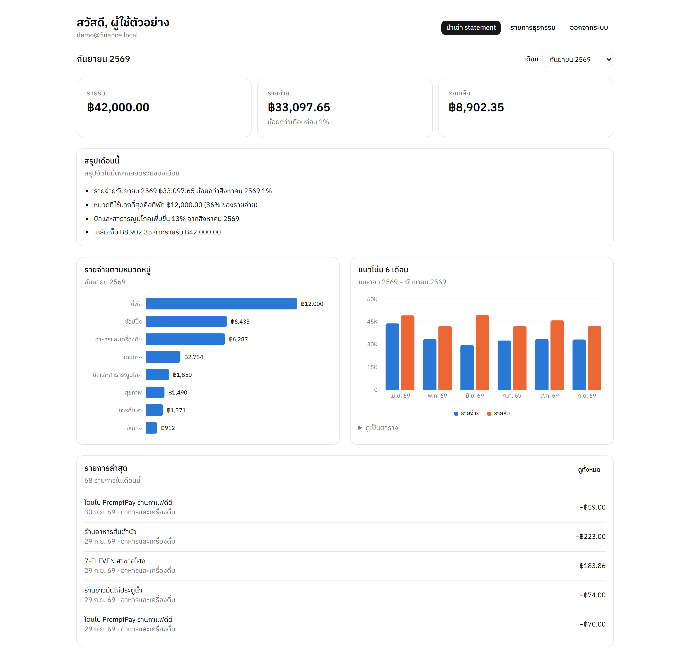
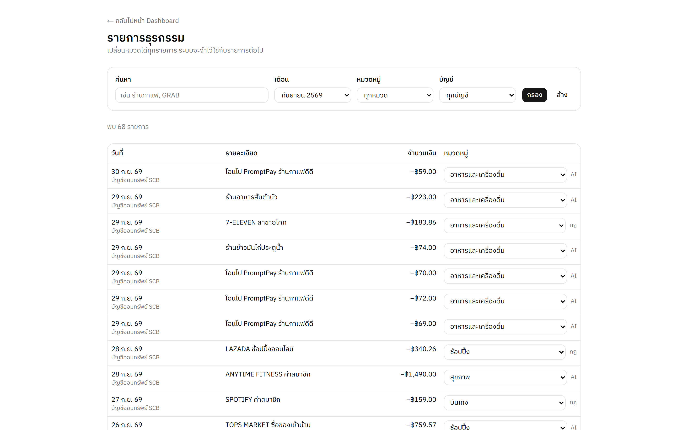
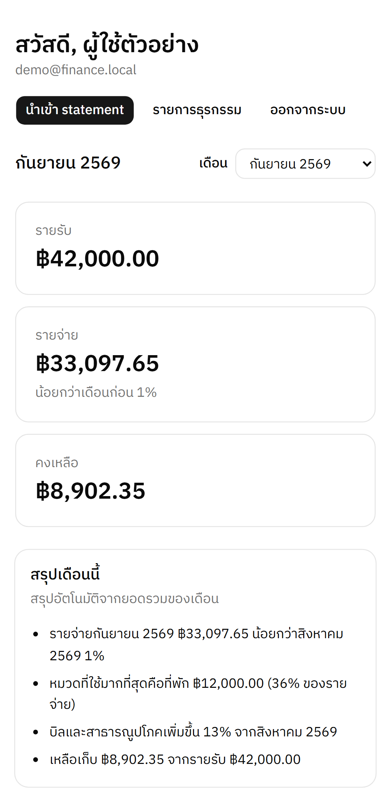
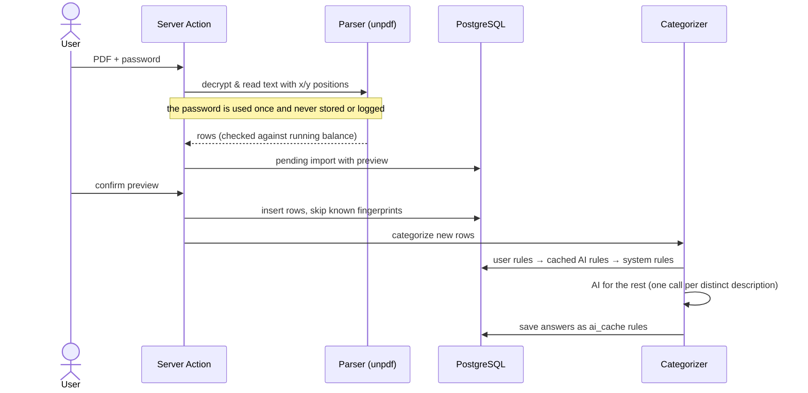

# Finance Dashboard

[](https://github.com/sariffff/finance-dashboard/actions/workflows/ci.yml)

A personal finance dashboard for Thai bank accounts. Upload the password-protected PDF e-Statement from your bank (or a photo of a transfer slip); the app reads every transaction, categorizes it automatically — rules first, then an LLM (Claude or Gemini), with every AI answer cached as a new rule — and shows where the money went.

> **ภาษาไทย:** แดชบอร์ดการเงินส่วนตัวสำหรับบัญชีธนาคารไทย อัปโหลด e-Statement PDF (ที่มีรหัสผ่าน) หรือรูปสลิปโอนเงิน ระบบอ่านรายการ จัดหมวดหมู่อัตโนมัติด้วยกฎ + AI และสรุปรายรับรายจ่ายรายเดือนเป็นภาษาไทย



<table>
  <tr>
    <td width="70%"></td>
    <td width="30%"></td>
  </tr>
</table>

## The problem

Thai banks hand you a monthly statement as a **password-protected PDF** — no CSV for personal accounts, and descriptions such as `โอนไป PromptPay ร้านกาแฟดีดี` or `GRAB* A-ABC123`. Budgeting apps either want you to type every transaction or ask for your bank login. This app works from the files you already have, never stores the PDF password, and keeps the originals in private storage that only you can open.

## Features

- **Statement import (SCB, KBANK)** — reads password-protected PDFs by text position, handles multi-line descriptions and multi-page statements, checks every row against the running balance, and shows a **preview** before anything is saved.
- **No duplicates** — a stable fingerprint per row means re-importing a statement, or one whose period overlaps, adds nothing twice. A transfer recorded from a **slip** is recognised when the statement arrives later, and vice versa.
- **Automatic categories: rules → AI → cache** — known merchants are matched by rules; the rest go to the AI in batches; every AI answer becomes a cached rule, so the same shop never costs an API call again. Fix a category once and choose "always use this for this shop".
- **Slip reading** — upload a transfer slip image; the AI reads date, amount and recipient for you to check (or type it in yourself without an API key).
- **Two AI providers** — Claude or Gemini, chosen by model name per task (e.g. a cheap Gemini Flash-Lite for categorizing, a stronger model for slips). Both go through the same prompts and the same validation.
- **Dashboard** — monthly income / spending / balance with month-on-month change, spending by category, a 6-month trend (also available as a table), recent transactions; works on a phone.
- **Monthly summary in Thai** — numbers are computed in SQL; only the totals go to the AI, and any sentence whose numbers don't match the data is dropped. Without an API key a rule-based summary is shown instead.
- **Private file storage** — original statements and slips live in a private S3-compatible bucket (Cloudflare R2 in production), downloadable only through 60-second signed URLs after an ownership check, and deletable by their owner.
- **Demo account** — one click on the sign-in page opens 12 months of realistic, fictional data.

## Architecture

```mermaid
flowchart LR
  user([Browser]) -->|HTTPS| caddy[Caddy<br/>reverse proxy + TLS]
  caddy --> app

  subgraph app[Next.js app]
    direction TB
    ui[Server Components<br/>+ Server Actions] --> dal[requireUser&#40;&#41;<br/>session check]
    dal --> queries[src/db/queries/*<br/>every query takes userId]
    ui --> parsers[PDF parsers<br/>SCB · KBANK]
    ui --> categorize[Categorizer<br/>rules → AI → cache]
    ui --> insights[Monthly insights]
  end

  queries --> pg[(PostgreSQL 17)]
  categorize --> pg
  categorize -.->|uncategorized rows only| llm[[Claude or Gemini API]]
  insights -.->|monthly totals only| llm
  ui -.->|slip images| llm
  ui -->|originals, private| r2[(Cloudflare R2)]
```



**Import flow**



## Technical decisions

| Decision | Why |
|---|---|
| **Rules → AI → cache** for categories | Most spending repeats (the same café, the same app). Rules handle the known ones for free, the AI sees each *new* description once, and its answer becomes a rule. In the demo data, 451 of 802 rows (56%) match built-in rules, and the other 351 need only 15 distinct AI lookups — after which 11 new cached rules cover those merchants for good. |
| **Money as `numeric(14,2)`, integer satang in TypeScript** | Floats can't represent 0.10 exactly. Amounts are parsed into integer satang, summed in SQL, and only turned into baht numbers for drawing charts. |
| **Never trust AI output** | Every response — Claude's or Gemini's — is parsed with the same Zod schema, may only name categories that exist, and insight sentences whose numbers don't match the computed totals are removed. The app works fully without an API key. |
| **Provider chosen by model name** | `AI_MODEL=gemini-3.5-flash` or `claude-opus-5-5` (and per task via `AI_MODEL_<TASK>`) picks the provider; each task has one prompt and one validator shared by both SDK adapters. Swapping providers is a config change, and a missing key just turns that feature off. |
| **Authorization in one place** | No row-level security in the database, so every query lives in `src/db/queries/*`, takes the `userId` from `requireUser()` as its first argument, and tests check that user A cannot read user B's data. The proxy only does an optimistic cookie check. |
| **Parse PDFs by position, not by regex on text** | Statement text comes out of PDFs fragmented (Thai vowels split, words in pieces). Parsers locate columns from the header's x-positions; a shared table reader means a new bank is mostly a layout config. Thai text is normalised before matching. |
| **Sensitive data handling** | PDF passwords are used once in memory. Original files are private, served only via short-lived signed URLs after an ownership check, and the owner can delete them. |
| **PostgreSQL in Docker, not a hosted BaaS** | Full control of schema and migrations (Drizzle), the same database locally, in CI and in production, and a one-command self-hosted deploy. |
| **Deterministic demo data through the real pipeline** | The demo is generated per month from a fixed seed, imported as statements, and categorized by the real code with a replay of known answers — so the demo shows rule, AI and uncategorized rows without spending on API calls. |

## Tech stack

- **Next.js 16** (App Router, Server Actions, Cache Components / Partial Prerendering) · **React 19** · **TypeScript** (strict)
- **Tailwind CSS 4** + **shadcn/ui**, charts with **Recharts** (palette checked for colour-vision deficiency and contrast in light and dark)
- **PostgreSQL 17** · **Drizzle ORM** + drizzle-kit migrations · **postgres.js**
- **Better Auth** (email + password)
- **Zod** for every input from users and the AI
- **Claude** via `@anthropic-ai/sdk` or **Gemini** via `@google/genai` (categorization, slip reading, monthly summaries)
- **unpdf** for password-protected PDF parsing
- S3 API (`@aws-sdk/client-s3`): **RustFS** locally, **Cloudflare R2** in production
- **Vitest** (unit + integration against a real database) · **Playwright** (end-to-end)
- **Docker** multi-stage image, **Caddy** for HTTPS, **GitHub Actions** CI

## Running locally

Requirements: Node.js 22, Docker.

```bash
cp .env.example .env            # then set passwords and BETTER_AUTH_SECRET (openssl rand -base64 32)
docker compose up -d            # PostgreSQL (localhost:5433), Adminer (:8080), RustFS file storage (:9001)
npm install
npm run db:migrate
npm run db:seed                 # categories, rules and the demo account with 12 months of data
npm run dev                     # http://localhost:3000 → "ลองใช้ด้วยบัญชีตัวอย่าง"
```

AI is optional. Set `ANTHROPIC_API_KEY` and/or `GEMINI_API_KEY`; with no `AI_MODEL` the app picks `claude-opus-5-5` or `gemini-3.5-flash` by which key is present. Without a key, categories come from rules only and the summary is rule-based.

Fictional statements to try the import with are in `src/lib/parsers/__fixtures__/` (`scb-statement.pdf`, password `01011990`; `kbank-statement.pdf`, password `15061995`).

## Tests

```bash
npm run lint && npm run typecheck
npm test              # Vitest: parsers, dedupe, categorization, AI validation, authorization, queries (needs the Docker database)
npm run test:e2e      # Playwright: sign-up/sign-in, PDF import with preview and duplicate detection, dashboard on desktop and mobile
```

Tests never call a real AI API — the Claude and Gemini adapters take an injectable stub client, and the e2e server is started with the keys blanked. CI runs everything above plus both Docker image builds on every push and pull request.

## Deployment

`docker-compose.prod.yml` runs PostgreSQL, a one-shot migration container, the app, and Caddy with automatic HTTPS; only Caddy is exposed. See [docs/DEPLOY.md](docs/DEPLOY.md) for a VPS walkthrough, updates, and the `pg_dump` backup script.

## Project structure

```
src/
  app/                 routes: (auth) sign-in/up, dashboard, import + preview, transactions, api/health
  db/
    schema.ts          tables (Better Auth tables generated into auth-schema.ts)
    queries/           all data access, always scoped by userId
    demo-data.ts       deterministic demo history generator
  lib/
    parsers/           one module per bank + shared table reader
    ai/                model list, provider choice, Gemini JSON helper
    categorize/        rules, Claude/Gemini categorizers, pipeline
    insights/          monthly facts (SQL) → Thai summary
    slips/             slip image reader
    import/            dedupe fingerprints, slip ↔ statement matching
e2e/                   Playwright tests
docs/                  PLAN.md (roadmap), DEPLOY.md
```

## Known limitations

- The SCB and KBANK parsers are built from publicly documented layouts and tested against generated fixtures; they have not yet been verified against real statements.
- Two banks so far. Adding one means a layout config in `src/lib/parsers/` plus a fixture.
